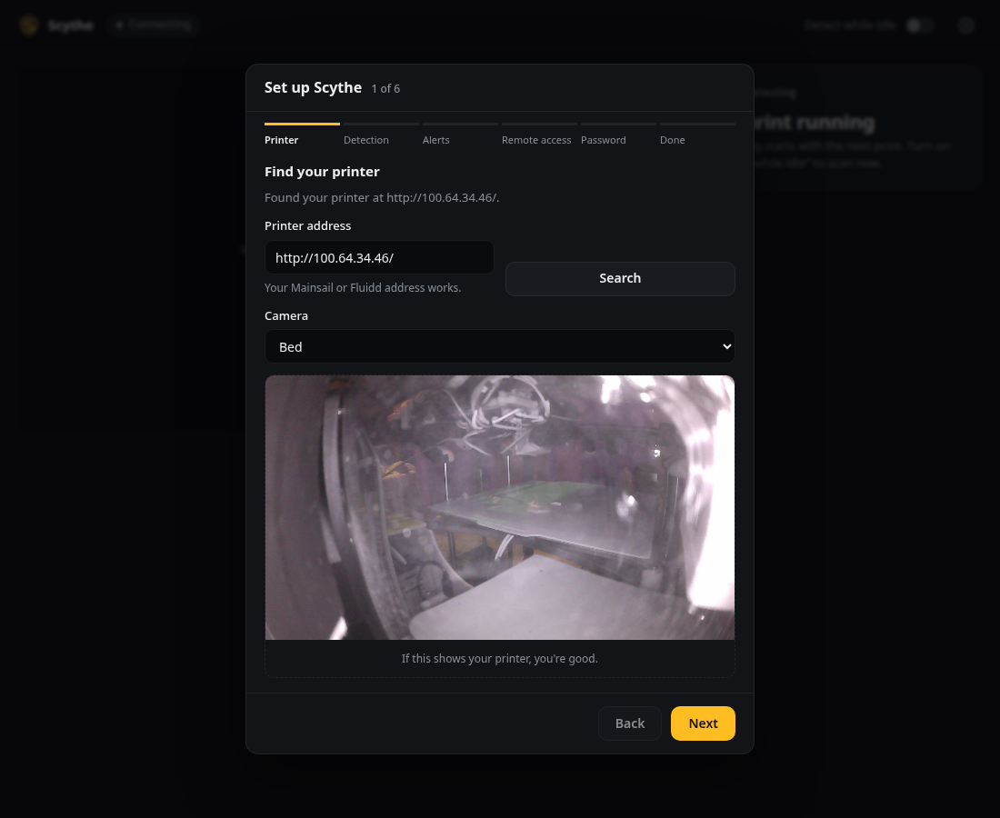

# Scythe-Spaghetti-Detection

Scythe-Spaghetti-Detection watches your 3D printer's camera and pauses the print when it fails. It runs on your own hardware, next to Klipper, and works with any printer that Moonraker drives.



- **Two ways to detect failures.** The recommended AI decision model (OpenRouter, or self-hosted with Ollama) catches spaghetti, layer shifts, warping, stringing, under-extrusion, cracking and parts knocked loose, for under a cent per print-hour. The bundled local model is free and private, but only catches spaghetti.
- **Web dashboard** with the live frame, detection boxes, and pause, resume and dismiss buttons.
- **Discord alerts** with a photo, plus slash commands to pause or check the printer.
- **Remote access through Tailscale**, set up from the dashboard, with no ports opened.
- **Mainsail sidebar link**, so Scythe opens inside your printer's address.

Hello, thanks for checking out my project! Scythe is a simple, lightweight, open source and self-hosted 3D printer failure detector, written entirely in Python. It's still in its early stages, so keep that in mind before trusting it with a long print. If you find any issues, please [open an issue](https://github.com/DarkEden-coding/Scythe-Spaghetti-detection/issues) or a pull request, and any showcase of how you're using it would be greatly appreciated; you can reach me using the info below. If master ever has broken code, I deeply apologize: I'm still fairly new to the open source community, so please contact me as soon as possible!

## Install

On your Klipper Pi, or any Linux machine that can reach the printer, run this as your normal user (not root):

```bash
curl -fsSL https://raw.githubusercontent.com/DarkEden-coding/Scythe-Spaghetti-detection/master/install.sh | bash
```

It takes a few minutes on a Pi. The installer:

- installs the newest release into `~/scythe` with its own Python, so it won't touch Klipper's;
- downloads the detection model (175 MB);
- starts Scythe as a `scythe` systemd service on the first free port from 8090;
- on a Klipper host, adds Scythe to Moonraker's update manager.

At the end it prints an address like `http://192.168.1.50:8090/`.

You need a 64-bit OS for the local model. On 32-bit Raspberry Pi OS, Scythe installs with the AI decision model only.

## Set up

Open the address the installer printed. A setup wizard walks you through:

1. **Printer.** Scythe finds Moonraker on the same machine by itself. Pick your camera and check the test picture.
2. **Detection.** The AI decision model is recommended and needs an [OpenRouter key](https://openrouter.ai/keys). The local model needs nothing.
3. **Discord alerts** (optional), with a step-by-step guide to making the bot.
4. **Remote access** (optional). One click installs Tailscale, another gives Scythe an HTTPS address like `https://printer.your-tailnet.ts.net/`. Another adds Scythe to Mainsail's sidebar.
5. **Password** (optional).

Then Scythe restarts and starts watching. Everything stays changeable later from **Settings** (the gear icon).

## Update

On a Klipper host, Scythe shows up in the **Update** panel of Mainsail or Fluidd next to Klipper and Moonraker. Elsewhere it updates itself to each new release when it starts. Running the install command again also updates it.

## Uninstall

```bash
~/scythe/install.sh --uninstall          # keeps your settings
~/scythe/install.sh --uninstall --purge  # deletes everything
```

This removes the service, the Mainsail link and the Moonraker entry. Tailscale stays installed.

## More

- [Detection](docs/detection.md): how the two backends work, and tuning crop, threshold and rates.
- [Discord](docs/discord.md): making the bot, and the slash commands.
- [Remote access](docs/remote-access.md): Tailscale and the Mainsail link, including manual steps.
- [Configuration](docs/configuration.md): every setting and its environment variable.
- [Troubleshooting](docs/troubleshooting.md)
- [Development](docs/development.md): running from source, tests, training, releases.

## Contact

Pull requests are welcome. You can reach me on Discord as `scytheeden`, or at `darkedenc9@gmail.com`. If you have GPU time to spare for training bigger models, I'd love to hear from you.

Scythe can miss failures. Use it at your own risk; I'm not responsible for damage to your printer.
